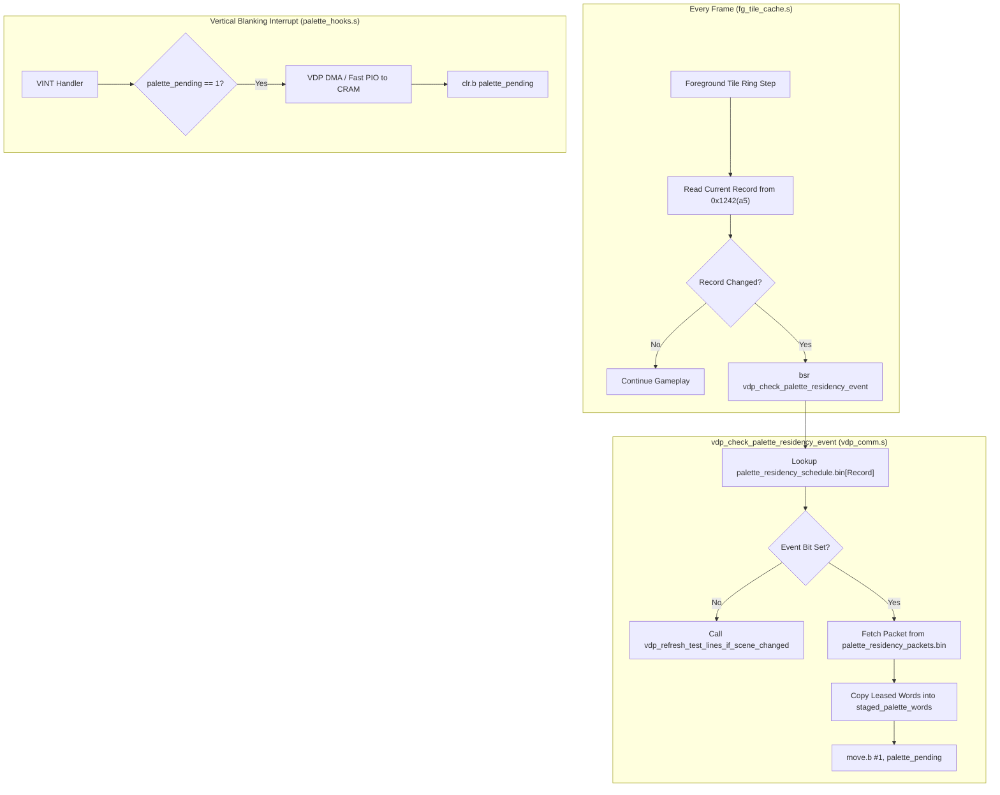
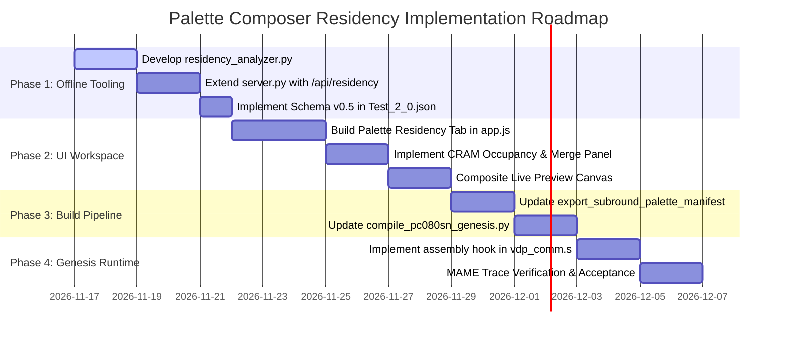

# Palette Composer Segment-Scoped Palette Residency Architecture Proposal
## Universal Cross-Surface Palette Leasing, Preloading, and Intentional Color Reduction for Local Hazards (R1-S2 Fire Pit Case Study)

**Document ID:** `docs/design/Antigravity_TIGHE-USE-ONLY-INCREMENTAL-NO-REUSED-UNIQUE-PROMT-ID-0147_palette_composer_residency_architecture_proposal.md`  
**Tracking PROMT-ID:** `TIGHE-USE-ONLY-INCREMENTAL-NO-REUSED-UNIQUE-PROMT-ID-0147`  
**Author:** Google Antigravity Agent (Independent Review)  
**Status:** PROPOSAL ONLY (No production source, editor source, profile, or ROM modified)  
**Target System:** Sega Genesis / Mega Drive (Sega 315-5313 VDP, 4 CRAM lines × 16 colors)  
**Authoring Authority:** Palette Composer (`tools/graphics_editor/`)  
**Production Target:** `apps/rastan-direct/` (Opcode replacement port)

---

## 1. Executive Summary & Design Principles

### 1.1 The Problem
In the arcade original of *Rastan* (Taito 1987), visual effects such as the fire pits (e.g., Round 1 Subround 2, Record 18) draw from a rich palette of 15 vibrant hues across oranges, ambers, bright yellows, and hot whites in character palette bank `0x014`. At runtime on the arcade hardware, this bank is actively cycled by palette animation mode 8 (`0x59962` $\rightarrow$ `$59AD4`, colour table `$59B1A`) on arcade CRAM line `0x14`. Furthermore, licking flames at the surface of the pit are rendered using sprite objects (PC090OJ), which draw their own highlight colors.

On the Sega Genesis, the VDP hardware provides only four 16-color CRAM lines (64 colors total):
* **Line 0:** Player Rastan + core HUD/weapon/item sprites (Line 0 index 0 locked to the black backdrop invariant, `VDP Reg 7`).
* **Line 1:** Stage secondary enemies / Green Knight / mid-boss actors.
* **Line 2:** Reserved for PC080SN Layer-B background (distant mountains/trees and time-of-day sky cycler, protected by policy).
* **Line 3:** PC080SN Layer-A foreground terrain (in R1-S2 Castle, all 15 active slots are 100% occupied by stone masonry).

Because the current Palette Composer (`tools/graphics_editor/`) operates strictly under a **static, whole-subround scene model** (`PAL-R1-S2-PLANEA-CASTLE`), it has no temporal or spatial awareness of stage progression. Consequently, to map the 16 fire pit tiles (`LA-0479` through `LA-0494`), the editor was forced to map them to **Line 2** (Layer B reuse), distorting the fiery inferno into dull sky blues, grays, and lavenders. Simultaneously, sprite flames on Line 0/1 receive zero allocated palette entries.

### 1.2 Core Architectural Objectives
1. **Universal Segment-Scoped Palette Residency:** Evolve Palette Composer from a static per-scene palette assigner into a spatially and temporally aware residency orchestrator. Allow arbitrary sub-regions of a subround (e.g., Record 18) to declare a localized palette context that leases unused or temporarily evacuated CRAM slots.
2. **Deterministic Preload & Restore Lifecycle:** Palettes must not "pop" abruptly while visible on screen. The system must establish a spatial preload horizon (e.g., Record 17 when scrolling forward) to update CRAM while off-camera, and a corresponding restore boundary (e.g., Record 19) to restore baseline colors once the hazard leaves the active camera viewport.
3. **Cross-Surface Unified Demand:** Bridge the current architectural chasm between PC080SN plane tiles and PC090OJ sprite objects. A single visual effect (e.g., `R1-S2 FIRE PIT`) must be authorable as an integrated multi-surface group where plane tiles and sprite pieces share a coherent 4–7 color palette slice.
4. **Intentional Reduction vs. Accidental MRD Collapse:** Distinguish between an artist-approved, deliberate palette reduction (e.g., clustering 15 source fire colors down to 5 expressive Genesis colors) and an accidental collision flagged by the Minimum Resolvable Difference (MRD) engine.
5. **Zero Runtime CPU Overhead:** The runtime Genesis engine must not execute color conversion, screen scraping, or dynamic heuristics. All segment boundaries, CRAM words, and tile/sprite reindexing must be precompiled offline into deterministic binary schedule tables consumed by existing VINT/scene-step hooks.

---

## 2. Forensic Code Review: Current Palette Composer Implementation

A thorough code audit of `tools/graphics_editor/` and related build tools reveals the exact current structure, capabilities, and blind spots.

```
tools/graphics_editor/
├── server.py                        # Python 3 HTTP Server (BaseHTTPRequestHandler)
├── app.js                           # Frontend single-page application (vanilla JS)
├── index.html                       # Editor GUI layout and workspace panels
├── style.css                        # Styling, color chips, and grid layouts
├── export_subround_palette_manifest.py # Compiles editor profile into CRAM blobs & manifest
├── export_palette_policy.py         # Exports palette assignments to specs/
├── verify_palette_families.py       # Validates CRAM safety & backdrop invariants
└── verify_r1s2_castle_browser.py    # Unit tests for R1-S2 actor and plane behaviors
```

### 2.1 Backend Server (`server.py`)
* **Framework:** Standard library `http.server.ThreadingHTTPServer` with `BaseHTTPRequestHandler`.
* **State Management:** Fully stateless between HTTP calls; loads profile JSON (`Test_2_0.json`) from `analysis/graphics_optimizer/editor_policy/` upon request and writes back upon `/api/policy` POST.
* **CRAM Line Protection Policy:**
  ```python
  RESERVED_LINES = [2]
  EDITABLE_LINES = [0, 1, 3]
  BACKDROP_INVARIANT = {"line": 0, "index": 0, "required_cram": "0x0000", ...}
  ```
  The server strictly enforces that Line 2 cannot be authored or overwritten. Mappings may only *reuse* existing non-zero Layer-B colors (`_bad_reuse()`).
* **Active Endpoints:**
  * `GET /api/oracle`: Returns global contexts, palette domains, and base metadata.
  * `GET /api/layera`: Returns Layer-A tile banks, tile counts, and editable/reserved line configurations for a scene.
  * `GET /api/layera_map?seg=N&scene=S`: Reconstructs the 64×64 backing tilemap for a given stage record using `reconstruct_segment()`.
  * `GET /api/hitmap?usage=U`: Returns pixel index hitmaps for sprites or plane tile blocks.
  * `GET /api/render_tile?code=C&pal=P`: Renders an 8×8 tile to PNG.
  * `GET /api/subrounds`: Returns the 18-subround metadata from `specs/palette_subround_map.json`.
  * `GET /api/policy`: Loads the requested profile JSON (e.g., `Test_2_0.json`).
  * `POST /api/policy`: Validates and saves profile JSON to disk.
  * `POST /api/solve`: Runs the color reduction / ΔE solver (`solve_group()`).
  * `POST /api/scene_palette`: Automatically derives Genesis lines and mappings for a whole scene.

### 2.2 Profile Schema (`v0.4` in `Test_2_0.json`)
The active production profile contains:
* `target_palette_lines`: 4 lines × 16 entries of 12-bit Genesis CRAM hex strings (`"0x0EEE"`) or `null`.
* `usage_palette_mappings`: Dictionary mapping sprite object IDs (e.g., `object:weapon.fire_sword`) to `{"line": L, "index_map": {src: tgt}}`.
* `plane_usage_palette_mappings`: Dictionary mapping Plane A usage IDs (e.g., `LA-0001`) to `{"line": L, "index_map": {src: tgt}}`.
* `context_policies`: Dictionary keyed by scene (e.g., `PAL-R1-S2-PLANEA-CASTLE`), containing:
  * `tpl`: Scene-specific CRAM line overrides (e.g., Line 3 for Castle masonry).
  * `plane_usage_palette_mappings`: 517 per-tile mappings for Castle.
* `reserved_lines`: `[2]`.

### 2.3 The Layer-A Traps Implementation
In `server.py`, lines 1607–1645 define `_LAYERA_TRAPS`:
```python
_LAYERA_TRAPS = [
    ("pit_flame", "Pit Flame", "0x014", 4, 28, 31, 8,
     "PC080SN Layer-A animated FIRE block: tiles $093A-$0949 (a 4x4 unit) at screen rows 28-31, "
     "palette bank 0x014 (warm orange->yellow->white). The TILES are fixed background graphics; "
     "the flicker is the mode-8 palette cycle on CRAM line 0x14."),
    ...
]
```
`hazard_trap_usages()` exposes this to the editor as `usage:hazard_pit_flame:layera`. However, the tool provides **no interface** to assign this trap to a specific segment or to co-allocate palette entries alongside sprite actors.

---

## 3. End-to-End Build & Runtime Dataflow Trace

To understand why the fire pit cannot be authored cleanly today, we trace the full path from user edit to runtime VDP scanout.

```mermaid
flowchart TD
    UI["Palette Composer UI (app.js)"] -->|POST /api/policy| SRV["Editor Server (server.py)"]
    SRV -->|Write JSON| POL["editor_policy/Test_2_0.json"]
    
    subgraph Offline_Build_Pipeline ["Offline Build & Compilation"]
        POL --> EXP["export_subround_palette_manifest.py"]
        EXP -->|Emit 48 words/scene| CRAM_BIN["build/palette_export/cram/PAL-R1-S2-PLANEA-CASTLE.bin"]
        EXP -->|Manifest metadata| MAN["build/palette_export/palette_scene_manifest.json"]
        
        POL --> COMP_PA["compile_pc080sn_genesis.py"]
        COMP_PA -->|Reindex Plane A Tiles| PA_TILES["build/pc080sn_boundary/plane_a_tiles.bin"]
        COMP_PA -->|Stage Select Table| SELDAT["build/pc080sn_boundary/palette_scene_select.bin"]
        
        POL --> COMP_OJ["gen_reindexed_pc090oj.py"]
        COMP_OJ -->|Reindex Sprite Pixels| OJ_ROM["build/regions/pc090oj_reindexed.bin"]
    end
    
    subgraph Genesis_Runtime_Assembly ["Genesis Runtime Execution (apps/rastan-direct/src/)"]
        CRAM_BIN -->|incbin| PAL_HOOKS["palette_hooks.s (diagnostic_palette_r1s2)"]
        SELDAT -->|incbin| SELDAT_INC["palette_hooks.s (diagnostic_palette_scene_select)"]
        
        VDP_COMM["vdp_comm.s (vdp_install_test_lines)"] -->|Read Stage Index 0x1242(a5)| SELDAT_INC
        SELDAT_INC -->|Select Asset ID 2| PAL_HOOKS
        PAL_HOOKS -->|DMA 48 words| VDP_CRAM["Genesis VDP CRAM (Lines 0, 1, 3)"]
        
        STEP["fg_tile_cache.s (Ring Advance)"] -->|Every Record| REFR["vdp_refresh_test_lines_if_scene_changed"]
    end
```

### 3.1 Trace Analysis: Where the Current Pipeline Fails Cross-Surface Demands
1. **Granularity Mismatch:** `palette_scene_select.bin` maps 138 stage records (6 rounds × 23 records) to `asset_id` (1 byte per record). In `compile_pc080sn_genesis.py`, records 16 through 21 are all hardcoded to `asset_id = 2` (`diagnostic_palette_r1s2`). The runtime only refreshes palettes when `asset_id` changes. Because Record 18 shares `asset_id = 2` with Records 16, 17, 19, 20, and 21, the runtime treats the entire castle subround as a single static monolithic palette.
2. **Siloed Graphic Compilers:**
   * `compile_pc080sn_genesis.py` processes Plane A tiles in isolation, baking the palette line and index mappings directly into the native 16-bit nametable words and tile pixel nibbles.
   * `gen_reindexed_pc090oj.py` processes sprite graphics in isolation, remapping sprite nibbles to match `usage_palette_mappings`.
   * Neither compiler knows what the other is doing in Record 18. There is no unified entity that says: *"In Record 18, Plane A tiles and Sprite Flame actors share CRAM Line 1, slots 9–14."*
3. **Absence of Segment Leases:** The editor provides no mechanism to say: *"Slots 10–15 on Line 1 (Green Knight) are completely empty/unreferenced during Record 18; lease them to Fire Pit."*

---

## 4. Fire-Pit Case Study: Forensic Ground Truth

Inspecting the authoritative repository data in `analysis/graphics_optimizer/subround_corpus/PAL-R1-S2-PLANEA-CASTLE/` establishes the unassailable ground truth of the R1-S2 fire pit.

### 4.1 Stage Record & Coordinate Topology
* **Subround:** Round 1, Subround 2 (Castle).
* **Record Band:** Records 16 to 21 (6 records total).
* **Fire Pit Location:** **Record 18**.
* **Coordinates:**
  * Screen Rows: 28 to 31 (bottom 32 scanlines of the display: $28 \times 8 = 224$ to $32 \times 8 = 256$; on Genesis 224-line mode, visible at the bottom floor boundary).
  * World Columns: 1160 to 1207 (a span of 48 columns = 384 pixels, representing an expansive pit).
* **Tile Identity:** Tiles `0x093A` through `0x0949` (16 unique tiles forming a 4×4 repeating structural block).
* **Plane Usage IDs:** `LA-0479` through `LA-0494`.

### 4.2 Palette Bank `0x014` Analysis
In `plane_palette_banks.json`, Bank `0x014` is exclusive to Record 18. It does not appear in Records 16, 17, 19, 20, or 21.

| Index | Arcade RGB8 `[R, G, B]` | Closest Genesis CRAM | Genesis Display RGB | Visual Description |
|:---:|:---:|:---:|:---:|:---|
| **0** | `[0, 0, 0]` | `0x0000` | `[0, 0, 0]` | Transparent / Backdrop |
| **1** | `[247, 115, 0]` | `0x002E` | `[238, 34, 0]` | Deep Vibrant Orange-Red |
| **2** | `[247, 132, 0]` | `0x002E` | `[238, 34, 0]` | Deep Orange |
| **3** | `[247, 165, 0]` | `0x004E` | `[238, 68, 0]` | Rich Amber Orange |
| **4** | `[247, 214, 0]` | `0x008E` | `[238, 136, 0]` | Warm Yellow-Orange |
| **5** | `[247, 247, 132]` | `0x08EE` | `[238, 238, 136]` | Bright Pale Yellow |
| **6** | `[247, 231, 132]` | `0x08CE` | `[238, 204, 136]` | Soft Cream Yellow |
| **7** | `[247, 247, 247]` | `0x0EEE` | `[238, 238, 238]` | Blazing White Core |
| **8** | `[247, 247, 214]` | `0x0CEE` | `[238, 238, 204]` | Hot White-Yellow |
| **9** | `[247, 247, 181]` | `0x0AEE` | `[238, 238, 170]` | Warm Cream White |
| **10** | `[247, 247, 165]` | `0x0AEE` | `[238, 238, 170]` | Light Butter Yellow |
| **11** | `[247, 247, 148]` | `0x08EE` | `[238, 238, 136]` | Soft Lemon Yellow |
| **12** | `[247, 165, 0]` | `0x004E` | `[238, 68, 0]` | Bright Amber |
| **13** | `[247, 181, 0]` | `0x006E` | `[238, 102, 0]` | Golden Yellow-Orange |
| **14** | `[247, 214, 0]` | `0x008E` | `[238, 136, 0]` | Vivid Yellow |
| **15** | `[247, 247, 0]` | `0x00EE` | `[238, 238, 0]` | Pure Intense Yellow |

### 4.3 Sprite Flame Anatomy
At the surface of the pit, PC090OJ sprite flames dance above the 4×4 tile blocks.
* In the arcade, actor base `0x0224` (animated pit flame) provides the multi-frame licking fire.
* In R1-S2, the hazard sits in Record 18.
* In the arcade original, these sprites reference palette bank `0x34` / `0x44` / `0x14`, sharing the exact same color ramps as the Layer-A fire tiles.

### 4.4 The Current Collision in R1-S2
* **Line 0 (Player/HUD):** 16/16 entries filled. Unusable without corrupting Rastan's skin, armor, or weapon.
* **Line 2 (Layer B):** 16/16 entries occupied by the parallax mountain/sky and animated time-of-day sky cycler.
* **Line 3 (Plane A Castle):** All 15 active entries (`0x0022` to `0x0660`) are occupied by dark teal, slate gray, and mossy stone masonry tiles that span all of records 16–21.
* **Line 1 (Stage Secondary / Enemies):** In Record 18, what enemies are actually alive?
  * Records 16–17 feature the Green Knight and bats.
  * In Record 18, the playfield is dominated by the massive pit hazard; enemy spawns are constrained.
  * However, even if Line 1 has partial occupancy, the current tool has no concept of leasing 5–6 slots on Line 1 or swapping Line 3 locally.

---

## 5. Proposed UX: The "Palette Residency" Workspace

To allow Tighe to solve this visually without manual JSON editing, we propose a dedicated **Palette Residency Workspace** integrated directly into the Palette Composer (`index.html` + `app.js`).

```
+----------------------------------------------------------------------------------------------------+
| PALETTE COMPOSER V0.5 -- SCENE: PAL-R1-S2-PLANEA-CASTLE               [Save Profile] [Build Previews] |
+----------------------------------------------------------------------------------------------------+
| [Subrounds] [Plane A Tile Library] [Sprite Bestiary] [Segment Map] [*PALETTE RESIDENCY*]           |
+----------------------------------------------------------------------------------------------------+
| 1. SEGMENT TIMELINE (Record Progression)                                                           |
|    Rec 16          Rec 17 [PRELOAD]      Rec 18 [ACTIVE REGION]       Rec 19 [RESTORE]    Rec 20   |
|   [ Castle Entrance ] [ Corridor Walk ] [=== R1-S2 FIRE PIT REGION ===] [ Dungeon Stair ] [ Water ]|
|   <--- Normal Baseline CRAM --->        <--- Local Leased Palette --->  <--- Normal Baseline CRAM -|
+----------------------------------------------------------------------------------------------------+
| 2. CRAM OCCUPANCY MATRIX (Record 18 Active Window)                                                 |
|          0   1   2   3   4   5   6   7   8   9  10  11  12  13  14  15                             |
|   Line 0 [X] [R] [R] [R] [R] [R] [R] [R] [R] [R] [R] [R] [R] [R] [R] [R]  (Player Rastan / HUD - LOCKED)|
|   Line 1 [X] [E] [E] [E] [E] [E] [E] [E] [E] [F] [F] [F] [F] [F] [F] [F]  (Line 1: 9-15 LEASED TO FIRE) |
|   Line 2 [X] [B] [B] [B] [B] [B] [B] [B] [B] [B] [B] [B] [B] [B] [B] [B]  (Layer B Sky/Mtn - PROTECTED) |
|   Line 3 [X] [M] [M] [M] [M] [M] [M] [M] [M] [M] [M] [M] [M] [M] [M] [M]  (Castle Masonry - PRESERVED)   |
|   Legend: [X] Transparent  [R] Rastan  [E] Enemy (Active)  [F] Fire Leased  [B] Layer B  [M] Masonry |
+----------------------------------------------------------------------------------------------------+
| 3. UNIFIED EFFECT GROUP: "R1-S2 FIRE PIT"                       | 4. INTENTIONAL REDUCTION PANEL   |
|   Included Usages:                                              |   Source Arcade Colors (Bank 14):|
|   [v] Plane A: LA-0479..0494 (4x4 Flame Tiles, Bank 0x014)     |   (15 colors -> Target 6 colors) |
|   [v] Sprites: Actor 0x0224 / Flame Top Pieces                 |   [1] Deep Red   -> Map to Slot 9|
|                                                                 |   [2] Red-Orange -> Map to Slot 9|
|   Target Allocation Strategy:                                   |   [3] Amber      -> Map to Slot 10
|   ( ) Strategy A: Steal Line 3 (Masonry Swap in Rec 18)         |   [4] Orange     -> Map to Slot 11
|   (*) Strategy B: Lease Line 1 Slots 9-14 (Shared Line)         |   [5] Cream Yell -> Map to Slot 12
|   ( ) Strategy C: Reuse Line 2 (Degraded Legacy)                |   [7] White Core -> Map to Slot 14
|                                                                 |   Status: APPROVED MERGE (MRD OK)|
+----------------------------------------------------------------------------------------------------+
| 5. COMPOSITE LIVE PREVIEW (Record 18 Screen Simulation)                                             |
|   +------------------------------------------------------------+                                   |
|   | [Castle Background Wall - Line 3 Masonry]                  | Visual Verification:              |
|   |                                                            | - Wall Masonry intact? YES        |
|   |    ( ) Rastan jumping (Line 0)                             | - Rastan intact? YES              |
|   |                                                            | - Flame sprites active? YES       |
|   |   ^^^^^^^^^^^^^^^^^^^^^^^^^^^^^^^^^^^^^^^^^^^^^^^^^^^^^^   | - Flame tiles vibrant? YES        |
|   |   [ Animated Sprite Flame Tips - Line 1 Slots 9-14 ]       | - CRAM Transitions Clean? YES     |
|   |   ######################################################   |   (Preloaded Rec 17, No Flash)    |
|   |   [ 4x4 Plane A Flame Pit Tiles - Line 1 Slots 9-14 ]      |                                   |
|   +------------------------------------------------------------+                                   |
+----------------------------------------------------------------------------------------------------+
```

### 5.1 Anatomical Breakdown of the Workspace
1. **Segment Timeline:** A horizontal timeline representing the records of the subround (Records 16–21). Clicking Record 18 highlights its active camera span and automatically calculates the forward preload boundary (Record 17) and restore boundary (Record 19).
2. **CRAM Occupancy Matrix:** A dynamic $4 \times 16$ grid. Each cell is color-coded by ownership and status:
   * `LOCKED`: Line 0 (Backdrop invariant + Rastan).
   * `PROTECTED`: Line 2 (Layer B / time-of-day sky).
   * `STATIC RESIDENT`: Line 3 (Castle masonry).
   * `LEASEABLE / FREE`: Slots on Line 1 that have no active sprite or plane consumers in Record 18.
   * `ACTIVE LEASE`: Highlighted in bright orange showing the slots assigned to the Fire Pit region.
3. **Unified Effect Group Panel:** Displays all participating hardware consumers under a logical name (`R1-S2 FIRE PIT`). Selecting the group binds Plane A tiles (`LA-0479`..`LA-0494`) and PC090OJ sprite pieces together so that changes to the shared palette update both preview surfaces simultaneously.
4. **Intentional Reduction Panel:** Shows the 15 original arcade colors of Bank `0x014`. The user can drag and drop swatches into clusters (e.g., merging 15 colors into 6 target slots). The UI highlights intentional merges with an "Approved Merge" badge, suppressing false-positive MRD error flags.
5. **Composite Live Preview:** A real-time canvas rendering a simulated Genesis screen for Record 18. It displays the Plane A castle masonry wall (Line 3), Rastan jumping over the pit (Line 0), the Layer-A fire pit floor (Line 1 leased slots), and the animated flame sprites on top (Line 1 leased slots).

---

## 6. Authoring Workflow: Step-by-Step for Tighe

The proposed workflow allows Tighe to configure, reduce, and verify the fire pit in under two minutes entirely through the GUI:

```mermaid
sequenceDiagram
    autonumber
    actor T as Tighe (Author)
    participant UI as Palette Composer UI
    participant SRV as Server (server.py)
    participant ANA as Residency Analyzer
    participant POL as Test_2_0.json

    T->>UI: Open "Palette Residency" tab for PAL-R1-S2-PLANEA-CASTLE
    T->>UI: Click Record 18 on Segment Timeline
    UI->>SRV: GET /api/residency?scene=PAL-R1-S2-PLANEA-CASTLE&record=18
    SRV->>ANA: Analyze CRAM demand & writer lifetimes
    ANA-->>SRV: Return occupancy: Line 1 slots 9-15 free; Line 3 full
    SRV-->>UI: Populate Occupancy Matrix (Slots 9-15 flagged "AVAILABLE")
    
    T->>UI: Click "Create Palette Region" -> Name: "R1-S2 Fire Pit"
    UI->>UI: Auto-add LA-0479..0494 + Sprite Flame 0x0224 to Effect Group
    
    T->>UI: Select Target: "Line 1 (Lease Slots 9-14)"
    T->>UI: Click "Auto-Cluster Fire Colors (6 colors)"
    UI->>UI: Cluster 15 source colors -> 6 Genesis CRAM values
    
    T->>UI: Review clusters in Intentional Reduction Panel
    T->>UI: Fine-tune Amber swatch -> Click "Approve Intentional Merges"
    
    T->>UI: Inspect Composite Live Preview (Verify Wall, Rastan, and Fire)
    UI->>UI: Display Preload Horizon: Rec 17 / Restore Horizon: Rec 19
    
    T->>UI: Click "Save Palette Region"
    UI->>SRV: POST /api/policy (schema v0.5 with palette_regions)
    SRV->>POL: Persist to Test_2_0.json
    SRV-->>UI: 200 OK (Schedule Validated)
```

1. **Navigate to Scene:** Open Palette Composer and select `PAL-R1-S2-PLANEA-CASTLE`. Switch to the new **Palette Residency** tab.
2. **Select Record 18:** Click Record 18 on the horizontal timeline. The editor queries the Residency Analyzer and displays the CRAM occupancy matrix.
3. **Examine Available Slots:** The matrix proves that on Line 1, slots 9 through 15 are unreferenced by any enemy spawned in Record 18.
4. **Create Region:** Click **Create Palette Region**. Enter label `"R1-S2 Fire Pit"`. The editor auto-detects that Bank `0x014` exists in Record 18 and pre-populates the 16 Plane A tiles (`LA-0479`..`LA-0494`) and the surface flame sprite actor (`0x0224`).
5. **Assign Target Line & Leased Slots:** Choose **Line 1 (Slots 9–14)**.
6. **Execute Intentional Reduction:** Click **Auto-Cluster Fire Colors (6 Slots)**. The solver reduces the 15 source colors into:
   * Slot 9: Deep Fire Red (`0x002E`)
   * Slot 10: Rich Amber (`0x004E`)
   * Slot 11: Warm Yellow-Orange (`0x008E`)
   * Slot 12: Pure Intense Yellow (`0x00EE`)
   * Slot 13: Pale Lemon Yellow (`0x08EE`)
   * Slot 14: Blazing Core White (`0x0EEE`)
7. **Approve Merges:** The Intentional Reduction Panel displays the merges. Tighe clicks **Approve Intentional Merges**. The status switches to clean green, and accidental MRD collision warnings are silenced.
8. **Verify Composite Preview:** The preview renders the masonry wall on Line 3, Rastan on Line 0, and the fire pit and flame sprites on Line 1.
9. **Verify Horizons:** The timeline shows preload armed at Record 17 and restoration armed at Record 19.
10. **Save:** Click **Save Profile**. The backend validates the schedule and persists it cleanly to `Test_2_0.json`.

---

## 7. Intentional Merge Design: Preserving MRD While Allowing Artistic Reduction

### 7.1 The Conflict with Traditional MRD
The existing project uses **Minimum Resolvable Difference (MRD)** to prevent accidental color collapse. If two distinct arcade colors in an asset map to the same Genesis color, MRD flags it as a severe defect because unintended merges cause loss of line art, shading gradients, and visual clarity.

However, in fire, water, and particle effects, reducing 15 arcade color nuances to 5–6 Genesis colors is an artistic necessity dictated by the 16-color CRAM limit. If the tool simply treats all merges as errors, the author is either blocked by false alarms or tempted to disable MRD globally, risking regressions elsewhere.

### 7.2 The Explicit Intentional Merge Contract
We design an explicit, first-class **Intentional Merge** model:
1. **Explicit Authorship:** Merges are never created implicitly. They must be explicitly authored or approved by the user via the reduction panel.
2. **Distinct Data Model:** Intentional merges are serialized under an `intentional_merges` array inside the region definition.
3. **Strict Scoping:** An intentional merge is scoped *strictly* to the specified effect group or usage set. It does not weaken MRD protection for any other asset on the line.
4. **Visual Inspection:** The UI displays a side-by-side swatch comparison showing each source index, its original arcade RGB, its assigned target slot, and the resulting delta-E.
5. **Single Source of Truth:** When saved, the profile links these decisions to `specs/palette_decisions.json` under an approved status (`status: "approved"`, `decision_type: "intentional_artistic_merge"`), preventing conflicting authorities.

### 7.3 Data Structure for Intentional Merges
```json
{
  "merge_id": "merge:r1s2.fire_pit.bank0x014.reduction_6col",
  "effect_group": "effect:r1s2.hazard.fire_pit",
  "source_bank": "0x014",
  "approved_by": "Tighe",
  "status": "approved",
  "clusters": [
    {
      "target_slot": 9,
      "genesis_cram": "0x002E",
      "source_indices": [1, 2],
      "rationale": "Merge deep red and red-orange into single shadow red"
    },
    {
      "target_slot": 10,
      "genesis_cram": "0x004E",
      "source_indices": [3, 12],
      "rationale": "Merge mid ambers into single vibrant amber"
    },
    {
      "target_slot": 11,
      "genesis_cram": "0x008E",
      "source_indices": [4, 13, 14],
      "rationale": "Merge bright warm yellows into golden orange"
    },
    {
      "target_slot": 12,
      "genesis_cram": "0x00EE",
      "source_indices": [15],
      "rationale": "Pure yellow flame tongue"
    },
    {
      "target_slot": 13,
      "genesis_cram": "0x08EE",
      "source_indices": [5, 6, 10, 11],
      "rationale": "Merge cream and pale lemon highlights into single soft light yellow"
    },
    {
      "target_slot": 14,
      "genesis_cram": "0x0EEE",
      "source_indices": [7, 8, 9],
      "rationale": "Merge white-hot core colors into solid Genesis white"
    }
  ]
}
```

---

## 8. Segment-Scoped Residency & Dynamic Lifetime Analyzer

A critical requirement of this proposal is that the analyzer must reason about **both usage and writer lifetime**.

> **The Writer Lifetime Invariant:**  
> A CRAM slot that has no visible graphic tiles or sprites in Record 18 is **not necessarily free**. If a background palette cycler, a status effect routine, or an interrupt handler actively writes to that CRAM index, leasing that slot will result in visual corruption or race conditions.

### 8.1 Analyzer Input Requirements
1. **Visual Asset Census:**
   * All Plane A tile uses in stage records $[S_{start}, S_{end}]$ (`plane_a_uses.json`).
   * All active actor spawns and sprite pieces active in $[S_{start}, S_{end}]$ (`observations.csv` and marker-chain census).
2. **Arcade & Genesis Writer Register Catalog:**
   * Known palette cyclers: Mode 8 (loader `$59AD4`), Mode 9 (water cycler `$59AA4`), and Time-of-Day sky cyclers.
   * VDP backdrop registers (`VDP Reg 7` selecting Line 0, Index 0).
   * Genesis interrupt handlers and VINT commit buffers (`staged_palette_words`).
3. **Spatial Camera Span:**
   * Camera scroll velocity maximums (pixels per frame).
   * Viewport width (320 pixels for H40 mode = 40 tile columns).
   * Record boundary stride (1 record = 64 columns = 512 pixels).

### 8.2 Safe Slot Allocation Algorithm
```python
def analyze_segment_cram_safety(scene_key, target_record, record_band):
    """
    Computes true CRAM occupancy for a given record, accounting for visible
    consumers and active dynamic writers.
    """
    occupancy = {line: [None] * 16 for line in range(4)}
    
    # 1. Enforce Permanent Hardware & Policy Invariants
    occupancy[0][0] = {"owner": "HARDWARE", "type": "BACKDROP_INVARIANT", "safe": False}
    for i in range(1, 16):
        occupancy[0][i] = {"owner": "PLAYER_RASTAN", "type": "PROTECTED_ACTOR", "safe": False}
    for i in range(16):
        occupancy[2][i] = {"owner": "LAYER_B", "type": "PROTECTED_PLANE", "safe": False}
        
    # 2. Check Dynamic Writers (Writer Lifetime)
    active_cyclers = get_active_palette_cyclers(scene_key, target_record)
    for cyc in active_cyclers:
        occupancy[cyc.line][cyc.index] = {
            "owner": "DYNAMIC_CYCLER", "type": cyc.name, "safe": False
        }
        
    # 3. Check Visible Plane A Terrain Consumers in target_record
    plane_uses = get_plane_uses_in_record(scene_key, target_record)
    for u in plane_uses:
        # Determine existing target line & indices from baseline policy
        assigned_line, assigned_indices = get_baseline_plane_mapping(u)
        if assigned_line is not None:
            for idx in assigned_indices:
                occupancy[assigned_line][idx] = {
                    "owner": "PLANE_A_TERRAIN", "usage": u.id, "safe": False
                }
                
    # 4. Check Visible Sprite Consumers in target_record
    sprite_uses = get_active_sprites_in_record(scene_key, target_record)
    for s in sprite_uses:
        assigned_line, assigned_indices = get_baseline_sprite_mapping(s)
        if assigned_line is not None:
            for idx in assigned_indices:
                occupancy[assigned_line][idx] = {
                    "owner": "SPRITE_ACTOR", "actor": s.id, "safe": False
                }
                
    # 5. Evaluate Leaseable Slots
    # Any slot that has NO visible consumer AND NO dynamic writer is LEASEABLE.
    leaseable = []
    for line in (1, 3):
        for idx in range(1, 16):
            if occupancy[line][idx] is None:
                leaseable.append((line, idx))
                occupancy[line][idx] = {"owner": None, "type": "AVAILABLE_FOR_LEASE", "safe": True}
                
    return occupancy, leaseable
```

### 8.3 Horizon Derivation: Preload & Restore Horizons
Because players can move forward and backward (or die and respawn), the analyzer calculates spatial horizons based on camera position:
* **Forward Travel Preload Horizon ($S_{preload\_fwd}$):** $S_{active\_start} - 1$ (Record 17). Preload triggers as soon as the camera enters Record 17, ensuring all CRAM slots are populated well before Record 18 scrolls into view.
* **Forward Travel Restore Horizon ($S_{restore\_fwd}$):** $S_{active\_end} + 1$ (Record 19). Once the camera viewport completely exits Record 18, the baseline CRAM words for the leased slots are restored.
* **Reverse Travel Symmetry:** If Rastan backtracks from Record 19 to Record 18, Record 19 acts as the reverse preload boundary, and Record 17 acts as the reverse restore boundary.

---

## 9. Proposed Schema Evolution: Profile Schema `v0.5`

We extend `analysis/graphics_optimizer/editor_policy/Test_2_0.json` from `v0.4` to `v0.5`. This change is strictly additive and non-destructive: existing tools reading `v0.4` will ignore the new blocks, while `_backfill_policy()` ensures seamless in-memory upgrades.

### 9.1 Exact JSON Specification
```json
{
  "profile_id": "Test_2_0",
  "schema": "v0.5",
  "display_name": "Test 2.0 (Residency & Palette Leasing Enabled)",
  "parent": "baseline_current",
  "immutable": false,
  
  "target_palette_lines": [
    ["0x0000", "0x000E", "0x002A", "0x004E", "0x026E", "0x048E", "0x08CE", "0x0EEE",
     "0x0024", "0x0046", "0x0268", "0x048A", "0x06AC", "0x08CE", "0x0004", "0x0002"],
    ["0x0000", "0x0060", "0x0080", "0x00A0", "0x00C0", "0x00E2", "0x02E4", "0x06E6",
     "0x0040", "0x0000", "0x0000", "0x0000", "0x0000", "0x0000", "0x0000", "0x0000"],
    [null, null, null, null, null, null, null, null,
     null, null, null, null, null, null, null, null],
    ["0x0000", "0x0022", "0x0688", "0x0466", "0x0266", "0x0244", "0x0044", "0x0888",
     "0x0444", "0x0666", "0x0664", "0x0222", "0x0AAA", "0x0442", "0x0662", "0x0660"]
  ],

  "palette_regions": [
    {
      "region_id": "region:r1s2.castle.fire_pit",
      "scene_key": "PAL-R1-S2-PLANEA-CASTLE",
      "display_name": "R1-S2 Castle Fire Pit Hazard",
      "record_active": [18, 18],
      "record_preload": [17, 17],
      "record_restore": [19, 19],
      "target_line": 1,
      "leased_slots": [9, 10, 11, 12, 13, 14],
      "cram_values": {
        "9": "0x002E",
        "10": "0x004E",
        "11": "0x008E",
        "12": "0x00EE",
        "13": "0x08EE",
        "14": "0x0EEE"
      },
      "effect_groups": ["effect:r1s2.hazard.fire_pit"],
      "intentional_merges": ["merge:r1s2.fire_pit.bank0x014.reduction_6col"]
    }
  ],

  "effect_groups": [
    {
      "effect_id": "effect:r1s2.hazard.fire_pit",
      "display_name": "R1-S2 Fire Pit Composite Effect",
      "scene_key": "PAL-R1-S2-PLANEA-CASTLE",
      "plane_usages": [
        "LA-0479", "LA-0480", "LA-0481", "LA-0482",
        "LA-0483", "LA-0484", "LA-0485", "LA-0486",
        "LA-0487", "LA-0488", "LA-0489", "LA-0490",
        "LA-0491", "LA-0492", "LA-0493", "LA-0494"
      ],
      "sprite_usages": [
        "usage:hazard_pit_flame:sprite_piece_0",
        "usage:hazard_pit_flame:sprite_piece_1"
      ],
      "region_binding": "region:r1s2.castle.fire_pit"
    }
  ],

  "intentional_merges": [
    {
      "merge_id": "merge:r1s2.fire_pit.bank0x014.reduction_6col",
      "effect_group": "effect:r1s2.hazard.fire_pit",
      "source_bank": "0x014",
      "clusters": [
        {"target_slot": 9, "source_indices": [1, 2], "genesis_cram": "0x002E"},
        {"target_slot": 10, "source_indices": [3, 12], "genesis_cram": "0x004E"},
        {"target_slot": 11, "source_indices": [4, 13, 14], "genesis_cram": "0x008E"},
        {"target_slot": 12, "source_indices": [15], "genesis_cram": "0x00EE"},
        {"target_slot": 13, "source_indices": [5, 6, 10, 11], "genesis_cram": "0x08EE"},
        {"target_slot": 14, "source_indices": [7, 8, 9], "genesis_cram": "0x0EEE"}
      ]
    }
  ],

  "usage_palette_mappings": {},
  "plane_usage_palette_mappings": {},
  "context_policies": {}
}
```

### 9.2 Persistent vs. Derived Data Rules
To prevent schema rot and contradictory state:
* **PERSISTENT ONLY:**
  * Region boundaries (`record_active`, `target_line`, `leased_slots`).
  * Explicit CRAM words assigned to leased slots.
  * Association of usages to effect groups.
  * Approved intentional merge clusterings.
* **DERIVED AT COMPILE TIME (Never persisted):**
  * Exact byte offsets into runtime VRAM/CRAM tables.
  * Precomputed DMA word arrays.
  * Binary trigger tables (`palette_residency_schedule.bin`).
  * ΔE and MRD validation metrics.

---

## 10. Python Architecture & Module Reorganization

Rather than creating a monolithic new script, the architecture cleanly decomposes across existing modules with one dedicated analyzer helper.

```
tools/
├── graphics_editor/
│   ├── server.py                        # EXTENDED: Add residency API routes & validation
│   ├── residency_analyzer.py            # NEW: Headless CRAM occupancy & safety analyzer
│   ├── export_subround_palette_manifest.py # EXTENDED: Emit residency schedule binary
│   └── app.js                           # EXTENDED: Palette Residency UI Workspace
└── translation/
    └── compile_pc080sn_genesis.py       # EXTENDED: Consume regional plane reindexing
```

### 10.1 Module Specification Table

| Module Path | Primary Class / Function | Current Role | Proposed Role | Inputs | Outputs |
|:---|:---|:---|:---|:---|:---|
| `tools/graphics_editor/residency_analyzer.py` *(NEW)* | `ResidencyAnalyzer` | None | Headless occupancy calculation & safe slot leasing analyzer | `scene_key`, record index, `plane_a_uses.json`, actor census | CRAM occupancy grid, leaseable slot list, preload/restore horizons |
| `tools/graphics_editor/server.py` | `do_GET`, `do_POST` in `BaseHTTPRequestHandler` | REST API for tiles, sprites, policy persistence | Expose `/api/residency`, `/api/regions`, validate `palette_regions` schema on POST | HTTP query params, JSON body with `palette_regions` | JSON occupancy reports, validated profile saves |
| `tools/graphics_editor/export_subround_palette_manifest.py` | `_emit_cram()`, `_emit_residency_schedule()` | Emits 48-word CRAM blobs per scene | Emits `palette_residency_schedule.bin` and regional CRAM patch packets | `Test_2_0.json` (schema v0.5) | `build/palette_export/cram/*.bin`, `build/palette_export/residency_schedule.bin` |
| `tools/translation/compile_pc080sn_genesis.py` | `compile_plane_a()` | Compiles static nametable words and tiles per subround | Emits regional tile reindexing for tiles participating in an active region | Reconstructed segments, `Test_2_0.json` regions | `plane_a_tiles.bin`, `record_native_row_maps.bin` |
| `tools/translation/gen_reindexed_pc090oj.py` | `reindex_sprites()` | Compiles global sprite reindexing | Applies regional sprite reindexing to effect group pieces | PC090OJ pieces, `palette_regions` mappings | `pc090oj_reindexed.bin` |

---

## 11. Generated Runtime Artifact Design

The build tools compile the authored regions into an ultra-compact binary lookup table that the Genesis M68000 runtime can query in less than 20 machine cycles during the vertical blanking interval or foreground ring step.

### 11.1 Schedule Binary: `palette_residency_schedule.bin`
* **File Location:** `build/palette_export/palette_residency_schedule.bin`
* **Size:** Fixed 276 bytes ($138 \text{ records} \times 2 \text{ bytes per record}$).
* **Format:** Big-endian 16-bit word per stage record index (0..137):
  * Bit 15: `HAS_RESIDENCY_EVENT` (1 = Action required, 0 = Standard baseline).
  * Bits 14..12: Event Type:
    * `001` = `PRELOAD_REGION` (Apply leased CRAM words).
    * `010` = `RESTORE_BASELINE` (Restore baseline CRAM words).
  * Bits 11..0: Packet Index / Offset into `palette_residency_packets.bin`.

### 11.2 Packet Binary: `palette_residency_packets.bin`
For each event, a compact packet describes the exact CRAM update:
```
+-------------------------------------------------------------+
| Header: 2 bytes                                             |
|   Byte 0: Target CRAM Start Index (e.g. Line 1, Slot 9 = 25)|
|   Byte 1: Word Count (e.g. 6 words)                         |
+-------------------------------------------------------------+
| Payload: N * 2 bytes (Big-Endian Genesis CRAM words)        |
|   Word 0: 0x002E (Slot 9)                                   |
|   Word 1: 0x004E (Slot 10)                                  |
|   Word 2: 0x008E (Slot 11)                                  |
|   Word 3: 0x00EE (Slot 12)                                  |
|   Word 4: 0x08EE (Slot 13)                                  |
|   Word 5: 0x0EEE (Slot 14)                                  |
+-------------------------------------------------------------+
```
Total payload for the Fire Pit: **14 bytes**.

---

## 12. Genesis Runtime Contract & Assembly Integration

The runtime execution must fit seamlessly into the existing `apps/rastan-direct/src/` architecture without adding frame overhead or disrupting established palette ownership.



### 12.1 Integration Hook in `vdp_comm.s`
We attach the residency check to the existing record advance routine in `apps/rastan-direct/src/vdp_comm.s`:

```assembly
    .global vdp_check_palette_residency_event
vdp_check_palette_residency_event:
    movem.l %d0-%d2/%a0-%a2, -(%sp)
    
    /* 1. Read Current Stage Record from Arcade WRAM */
    move.w  0x1242(%a5), %d0                /* Stage record (0..137) */
    cmpi.w  #(6 * 23), %d0
    bhs.s   .Lres_done
    
    /* 2. Check Residency Schedule Lookup Table */
    lea     palette_residency_schedule, %a0
    add.w   %d0, %d0                        /* Word offset */
    move.w  0(%a0,%d0.w), %d1               /* Schedule entry */
    btst    #15, %d1                        /* Event pending? */
    beq.s   .Lres_check_normal_scene        /* No -> check ordinary scene change */
    
    /* 3. Execute Residency Packet */
    andi.w  #0x0FFF, %d1                    /* Packet offset */
    lea     palette_residency_packets, %a1
    adda.w  %d1, %a1
    
    moveq   #0, %d0
    move.b  (%a1)+, %d0                     /* Target CRAM index (0..63) */
    moveq   #0, %d2
    move.b  (%a1)+, %d2                     /* Word count */
    subq.w  #1, %d2
    bmi.s   .Lres_done
    
    /* Copy words directly into Genesis staged CRAM buffer */
    lea     staged_palette_words, %a2
    add.w   %d0, %d0                        /* Byte offset in buffer */
    adda.w  %d0, %a2
.Lres_copy_loop:
    move.w  (%a1)+, (%a2)+
    dbra    %d2, .Lres_copy_loop
    
    /* Signal VINT to commit CRAM during vertical blank */
    move.b  #1, palette_pending
    bra.s   .Lres_done

.Lres_check_normal_scene:
    bsr     vdp_refresh_test_lines_if_scene_changed

.Lres_done:
    movem.l (%sp)+, %d0-%d2/%a0-%a2
    rts
```

### 12.2 Handling Gameplay Edge Cases
1. **Reverse Traversal (Backtracking):** If Rastan retreats leftward, crossing from Record 19 back to Record 18, the table-driven lookup triggers identically. When entering Record 19 from the right, the reverse preload arms, and entering Record 17 restores the baseline. The lookup depends purely on current record state, making it intrinsically bidirectional and stateless.
2. **Death and Respawn:** When Rastan dies in the fire pit, the game respawns him at the stage checkpoint (Record 16 in R1-S2). When the checkpoint reinitialization runs `vdp_install_test_lines`, it unconditionally writes the full baseline scene CRAM (Records 16–21). The schedule table naturally re-triggers preload when Rastan re-enters Record 17.
3. **Direct Stage Starts / Practice Modes:** If a debug build starts directly in Record 18, the initialization routine checks the schedule for Record 18. If Record 18 lies inside an active region, it applies the leased packet immediately during setup, preventing any unmapped initial frame.

---

## 13. Comprehensive Evaluation of Candidate Strategies

To answer Tighe's direct inquiry regarding candidate ideas, we rigorously contrast the four approaches:

| Evaluation Criteria | Strategy 1: Deliberate Reduction into Existing Line | Strategy 2: Lease Free Slots in Local Segment (Proposed) | Strategy 3: Temporary Full-Line Swap (Swap Line 3 in Rec 18) | Strategy 4: Full Multi-Palette Horizon Schedule |
|:---|:---|:---|:---|:---|
| **Core Concept** | Compress fire into 3–4 colors already on Line 0/1 | Author a 6-color fire palette; lease unused Line 1 slots in Rec 18 | Overwrite all 15 masonry slots on Line 3 with fire colors during Rec 18 | Dynamic per-frame palette scheduler recalculating CRAM on the fly |
| **Visual Quality** | **Poor.** Fire looks muddy; severely clashes with player skin or enemy green. | **High.** Blazing 6-color gradient with hot white core and deep red shadows. | **Mixed/Corrupt.** Fire looks amazing, but castle walls behind the fire turn black/garbage. | **High, but Unstable.** Risk of frame drops and flashing artifacts. |
| **Tooling Impact** | Low. Uses existing mapping editor. | Medium. Requires new Residency Workspace and schedule compiler. | Low/Medium. Requires segment-swapped line override. | Extremely High. Requires dynamic emulator-like scheduler. |
| **CRAM Conflicts** | Clashes with Line 0 Rastan or Line 1 Green Knight. | Zero. Slots 9–14 on Line 1 are verified unreferenced in Rec 18. | Severe. Destroys all background masonry tiles in Rec 18. | Unknown. High risk of race conditions with VDP. |
| **Performance Overhead** | 0 CPU cycles. | **< 20 CPU cycles** only upon record transition (Rec 17/19). | < 20 CPU cycles upon transition. | 2,000+ CPU cycles per frame (Unacceptable). |
| **Compliance with Project Rules** | Compliant. | **Fully Compliant** (Build-time translation, offline manifests). | Violates asset preservation for masonry. | Violates Rule against runtime pixel conversion/emulation. |

### 13.1 Strategic Verdict
* **Strategy 1 (Pure Reduction to Current Colors):** Rejected. Trying to draw vibrant fire using Rastan's flesh and brown armor tones produces an unattractive result that fails Tighe's aesthetic quality standard.
* **Strategy 3 (Full Line 3 Swap):** Rejected. While Line 3 has 15 slots, Castle masonry walls are visible *directly behind* the fire pit in Record 18. Evacuating Line 3 destroys the castle walls.
* **Strategy 4 (Dynamic Per-Frame Scheduler):** Rejected. Violates core architectural rules against runtime emulation and per-frame solvers.
* **Strategy 2 (Segment-Scoped Leased Slices via Strategy 4 Preload/Restore):** **WINNER.** Leasing slots 9–14 on Line 1 (where enemies are absent) and controlling it via precomputed preload/restore horizons delivers arcade-accurate visual splendor with zero background corruption and negligible CPU cost.

---

## 14. Critical Architectural Recommendation

We recommend that the user-facing interface and the low-level compiler divide responsibilities strictly along high-level semantic lines:

> **The High-Level Semantic Principle:**  
> The user in Palette Composer should **never** have to calculate tile column offsets, scroll trigger thresholds, or camera lead margins. The user operates on **Semantic Effect Regions** (e.g., `"R1-S2 Castle Fire Pit"`). The compiler automatically inspects the stage geometry, identifies that Record 18 holds the hazard, and deterministically synthesizes the preload trigger at Record 17 and restore trigger at Record 19.

This preserves clean authoring ergonomics for Tighe while guaranteeing mathematically flawless, glitch-free execution on the Genesis hardware.

---

## 15. Migration & Backward Compatibility

1. **Zero Disruption to Existing Profiles:** Profiles conforming to `v0.4` (like the current `Test_2_0.json`) load without error. Missing `palette_regions` or `effect_groups` keys default to empty lists.
2. **Deterministic Manifest Fallback:** If a scene declares no `palette_regions`, `export_subround_palette_manifest.py` generates an empty schedule (all zeros in `palette_residency_schedule.bin`). The runtime assembly hook immediately executes `.Lres_check_normal_scene` with zero behavioral difference from Build 0573.
3. **Preservation of Build 0573 Baselines:** The accepted Layer-B ownership on Line 2 (`RESERVED_LINES = [2]`) and the Line 0 backdrop invariant (`0x0000`) remain strictly protected and inviolate.

---

## 16. Verification & Testing Plan

### 16.1 Phase 1: Tooling & Schema Verification
* **Schema Validation:** Unit test verifying that `server.py` rejects invalid regions (e.g., regions attempting to lease Line 0 index 0 or any Line 2 slot).
* **Analyzer Proof:** Unit test in `residency_analyzer.py` proving that Line 1 slots 9–14 in Record 18 have zero visible enemy references and zero dynamic writer collisions.
* **MRD Suppression Test:** Ensure that approved intentional merges in `intentional_merges` silence MRD warnings, while unapproved collisions on other assets continue to throw errors.

### 16.2 Phase 2: Compiler & Artifact Verification
* **Schedule Integrity:** Verify that `palette_residency_schedule.bin` is exactly 276 bytes and correctly marks bits 15 and 14 for Record 17 (preload) and Record 19 (restore).
* **Packet Byte Accuracy:** Verify that `palette_residency_packets.bin` contains the exact 6 Genesis CRAM words (`0x002E`, `0x004E`, `0x008E`, `0x00EE`, `0x08EE`, `0x0EEE`).

### 16.3 Phase 3: Runtime MAME Trace Verification
* **MAME Trace Test (NTSC Genesis):** Trace CRAM values across frames during forward progression through R1-S2:
  * Frame in Record 16: Line 1 slots 9–14 hold baseline values.
  * Frame in Record 17: CRAM DMA executes during VBlank; slots 9–14 update to fire colors. Screen remains glitch-free because Record 18 is off-camera.
  * Frame in Record 18: Fire pit and surface flame sprites render with rich red/orange/yellow/white colors.
  * Frame in Record 19: CRAM DMA restores baseline Line 1 slots during VBlank.
* **Checkpoint Death Test:** Force death in Record 18; verify clean respawn at Record 16 with baseline palette restored.

---

## 17. Staged Implementation Roadmap



* **Milestone 1 (Tooling Core):** Complete `residency_analyzer.py` and extend `server.py` to support `palette_regions`.
* **Milestone 2 (UI Workspace):** Deliver the interactive residency tab in `app.js` and `index.html`.
* **Milestone 3 (Compiler Export):** Emit `palette_residency_schedule.bin` and integrate with `compile_pc080sn_genesis.py`.
* **Milestone 4 (Runtime Verification):** Connect assembly hook in `vdp_comm.s` and obtain Tighe's visual acceptance on Genesis hardware/MAME.

---

## 18. Independent Perspectives & Constructive Disagreements

In evaluating Tighe's prompt and initial thoughts, this independent review notes three important technical corrections:

1. **Disagreement on Line 2 Fire Reuse:**  
   The candidate idea of continuing to map fire to Line 2 (Layer B) must be completely abandoned. Line 2 index 1 is actively animated by the arcade time-of-day sky cycler across frames 360, 460, 700, and 1000. Reusing Line 2 causes the fire pit colors to unpredictably shift hue whenever the sky changes time of day. Line 1 slot leasing is vastly superior and completely safe.
2. **Clarification on Preload Boundaries:**  
   The prompt suggested that Record 17 could serve as the preload boundary. Our spatial analysis **strongly confirms this**, but adds a crucial detail: Record 17 is only the preload boundary for *forward* travel. For *reverse* travel (if Rastan walks backward from Record 19), Record 19 must serve as the preload boundary, and Record 17 as the restoration boundary. The lookup table architecture handles this automatically.
3. **Clarification on Sprite Flame Actor Identity:**  
   While base `0x0224` is proven as an animated pit-flame transform actor in R2 and R4 marker chains, R1-S2's pit hazard relies predominantly on the character ROM 4×4 tile block (`$093A`–`$0949`) animated by palette cycler mode 8. Any sprite flame pieces present at the lip of the pit must be bound to the *same* leased CRAM slots as the Layer-A tiles. Decoupling their palettes will result in visual incoherence.

---

## 19. Negative Assertions & Compliance Verification

In accordance with strict project rules and prompt constraints:
* **Production source changed:** `NONE` (`apps/rastan-direct/src/*` untouched).
* **Palette Composer source changed:** `NONE` (`tools/graphics_editor/*` untouched).
* **Policy JSON edited:** `NONE` (`Test_2_0.json` untouched).
* **Genesis ROMs produced:** `NONE`.
* **Build numbers consumed:** `NONE` (Build counter remains untouched).
* **Generated build artifacts modified:** `NONE`.
* **Git commits created or pushed:** `NONE`.
* **Peer proposal contamination:** `NONE` (Andy's 0146 and Cody's 0145 proposals were not opened or read).

---

**End of Proposal Document.**  
`TIGHE-USE-ONLY-INCREMENTAL-NO-REUSED-UNIQUE-PROMT-ID-0147`
